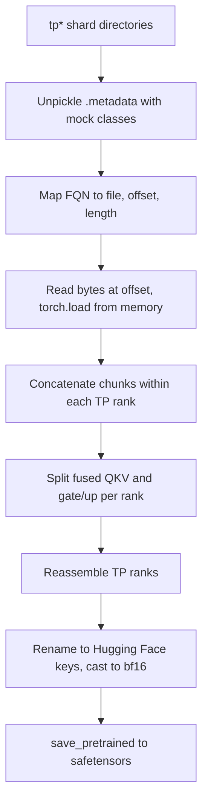

# llama3-70b-dcp-to-hf

Convert a Llama 3 70B checkpoint saved as custom PyTorch Distributed Checkpoint (DCP) shards with tensor parallelism 8 (TP=8) into Hugging Face `transformers` format (`safetensors`).

## TL;DR

```bash
pip install torch transformers safetensors tqdm

python consolidate_llama3.1_70b.py \
    --input_path /path/to/dcp_checkpoint \
    --output_path /path/to/hf_output
```

- `--input_path` is a directory with one `tp*` subdirectory per tensor-parallel rank (eight for this script).
- `--output_path` receives `config.json` and sharded `model-*.safetensors` files, with every weight cast to bf16.
- Both arguments are required. The script has no defaults.
- Read [Limitations](#limitations) before running it. Several values are hardcoded for Llama 3 70B with TP=8.

## What problem it solves

The training run produced checkpoints in a DCP-like layout that standard tooling cannot read:

- The `.__{n}_.metadata` index files are pickles of classes that are not importable outside the training stack, so a plain `pickle.load` fails with `ModuleNotFoundError`.
- Each tensor-parallel rank (`tp0`, `tp1`, ...) stores its slice of every weight, and a single slice can itself be split across several data files.
- Parameter names follow a Transformer-Engine style layout with fused projections (`layernorm_qkv`, `layernorm_mlp.fc1_weight`) instead of the separate `q_proj`/`k_proj`/`v_proj` and `gate_proj`/`up_proj` weights that Hugging Face expects.

This script reads the metadata without the original training code, reassembles the tensor-parallel slices, splits the fused weights, renames everything to the Hugging Face Llama convention and writes a standard checkpoint that `LlamaForCausalLM` can load.

## Requirements

- Python 3 with `torch`, `transformers`, `safetensors` and `tqdm`. No version pins are provided in this repository.
- A CPU host with a large amount of RAM. The script keeps the whole converted state dict in memory (about 2 bytes per parameter in bf16, so on the order of 140 GB for a 70B model by simple arithmetic) and then instantiates a `LlamaForCausalLM` before saving. No GPU is used. Plan memory for the model instantiation on top of the state dict.
- Local read access to all `tp*` directories and enough free disk space in the output directory for the bf16 weights.
- Only convert checkpoints you trust. Tensors are read with `torch.load(..., weights_only=False)`, which executes pickle data.

## Usage

```bash
python consolidate_llama3.1_70b.py \
    --input_path /path/to/dcp_checkpoint \
    --output_path /path/to/hf_output
```

Expected input layout:

```text
dcp_checkpoint/
    tp0_ep0/              # any directory name containing "tp"
        .__0_.metadata    # pickled index for chunk 0
        .__1_.metadata
        ...
        __0_0.distcp      # data files named in the metadata (relative_path)
        __1_0.distcp
        ...
    tp1_ep0/
    ...
    tp7_ep0/
```

Output:

- `config.json` written from the configuration hardcoded in the script.
- Sharded `model-*-of-*.safetensors` files (maximum 10GB each) and `model.safetensors.index.json`, written by `save_pretrained`.
- If building, loading or saving the model raises (for example a shape mismatch in `load_state_dict`), the script prints the error and falls back to a single `model.safetensors` containing the converted tensors.

The tokenizer is not converted or copied. Copy the tokenizer files from the matching Llama 3 / 3.1 release into the output directory before loading the model with `AutoTokenizer`.

Load the result with:

```python
import torch
from transformers import AutoModelForCausalLM

model = AutoModelForCausalLM.from_pretrained("/path/to/hf_output", torch_dtype=torch.bfloat16)
```

## How it works



### Metadata unpickling with mock classes

`CustomUnpickler` overrides `find_class`. For `MetadataIndex`, `_StoragePrefix`, `_StorageInfo`, `ChunkStorageMetadata` and `TensorStorageMetadata` it returns small local stand-in classes that simply store their attributes. Every other class is resolved normally. This is enough to read the `storage_data` mapping, in which each key carries an `fqn` (the fully qualified tensor name) and each value carries `relative_path`, `offset` and `length`. The loader unpickles `.__{chunk_idx}_.metadata` inside each shard directory and caches the result per shard and chunk.

### Byte-offset reads

The data files hold several `torch.save` streams back to back. For a given tensor the loader opens the file named by `relative_path`, seeks to `offset`, reads `length` bytes, wraps them in `io.BytesIO` and calls `torch.load` on the buffer. Only the bytes of the requested tensor are read from disk.

### Chunk concatenation and TP reassembly

- Shard discovery: every subdirectory of `--input_path` whose name contains `tp` is treated as a TP rank, sorted by name.
- Within a rank, chunk indices `0` to `19` are tried. For each chunk that has a metadata file, the first entry whose `fqn` equals the requested name is read. The chunks found are concatenated along dimension 0 in chunk order to form that rank's slice.
- Across ranks, slices are combined according to how the weight is partitioned:

| Weight | Combine across ranks |
| --- | --- |
| Embedding, fused QKV, fused gate/up, LM head | Concatenate along dim 0 (after splitting, for the fused ones) |
| Attention output projection (`o_proj`), MLP down projection (`fc2`) | Concatenate along dim 1 |
| Layer norm weights | Take rank 0 only (treated as replicated) |

### Fused QKV and gate/up splitting

The fused weights are split on each rank before the ranks are joined, so that each of Q, K, V (and gate, up) is concatenated across ranks on its own:

- QKV: each rank's `layernorm_qkv.weight` is split along dim 0 into `[1024, 128, 128]` rows (Q, K, V), then Q, K and V are each concatenated over the eight ranks. These sizes correspond to 64 query heads and 8 key/value heads of dimension 128, divided by 8 ranks.
- MLP: each rank's `layernorm_mlp.fc1_weight` is split along dim 0 into `[3584, 3584]` rows (gate, up), then each part is concatenated over the ranks. 3584 is the intermediate size 28672 divided by 8.
- No RoPE permutation is applied to Q and K, and the MLP order is gate first, then up. The script prints this configuration at startup. These two choices were established empirically during development (see [Validation tips](#validation-tips)).

### Name mapping

| Checkpoint name (under `state_dict.`) | Hugging Face name |
| --- | --- |
| `word_embedding.weight` | `model.embed_tokens.weight` |
| `transformer.seq_layers.{i}.layer.self_attention.layernorm_qkv.layer_norm_weight` | `model.layers.{i}.input_layernorm.weight` |
| `transformer.seq_layers.{i}.layer.self_attention.layernorm_qkv.weight` | `model.layers.{i}.self_attn.{q,k,v}_proj.weight` |
| `transformer.seq_layers.{i}.layer.self_attention.proj.weight` | `model.layers.{i}.self_attn.o_proj.weight` |
| `transformer.seq_layers.{i}.layer.layernorm_mlp.layer_norm_weight` | `model.layers.{i}.post_attention_layernorm.weight` |
| `transformer.seq_layers.{i}.layer.layernorm_mlp.fc1_weight` | `model.layers.{i}.mlp.{gate,up}_proj.weight` |
| `transformer.seq_layers.{i}.layer.layernorm_mlp.fc2_weight` | `model.layers.{i}.mlp.down_proj.weight` |
| `transformer.final_layernorm.weight`, falling back to `layernorm.weight` | `model.norm.weight` |
| `lm_head.weight`, falling back to `output_layer.weight` | `lm_head.weight` |

### Saving

The script writes `config.json`, builds a `LlamaForCausalLM` from the hardcoded config, loads the converted state dict with `strict=False`, converts the model to bf16 and calls `save_pretrained(..., safe_serialization=True, max_shard_size="10GB")`.

## Limitations

- Hardcoded to Llama 3 70B and TP=8. The 80 layers, the QKV split sizes (`1024/128/128`) and the gate/up split sizes (`3584/3584`) are constants in the script. A different TP degree or model size needs code changes. If a QKV slice has an unexpected shape, the layer is added to the missing list and the remaining ranks are skipped, but Q, K and V are still built from the ranks processed before it, so they come out too small (or are not written at all if the first rank fails). A gate/up shape mismatch raises and stops the run.
- The Hugging Face config is hardcoded as well: `max_position_embeddings=8192`, `rope_theta=500000.0`, no `rope_scaling`, untied embeddings. It does not include the extended-context RoPE scaling that the Llama 3.1 release defines. Edit `LLAMA3_70B_CONFIG` or the written `config.json` if your model needs different values.
- All weights are cast to bf16, whatever dtype they had in the checkpoint.
- Only the tensors listed in the name mapping are read. Any other entries in the checkpoint (extra state, optimizer state) are ignored.
- Layout assumptions: shard directories contain `tp` in their name and sort in rank order (fine for `tp0` to `tp7`, not for names that sort differently); chunk metadata files are named `.__{n}_.metadata` with `n` below 20; each chunk holds at most one entry for a given FQN; layer norms are identical on all ranks.
- Missing or unreadable data does not stop the run. A tensor that cannot be found is added to a missing list and the script prints a warning with only the first five entries. A chunk that fails to read is skipped after printing an error, so the rank's slice may come out shorter than expected. The model is then loaded with `strict=False`, so any missing weight stays at its random initialization and is still written to the output. Check the log for `MISSING TENSORS` and read errors, and do not rely on the output files alone to detect an incomplete conversion.
- No tokenizer, and no automated tests, are included.

## Validation tips

- Read the whole conversion log. A clean run prints `All tensors found.` and has no `Failed to read/deserialize` lines.
- Check tensor shapes against the Llama 3 70B reference: for example `q_proj` is `[8192, 8192]`, `k_proj` and `v_proj` are `[1024, 8192]`, `gate_proj` and `up_proj` are `[28672, 8192]`, `down_proj` is `[8192, 28672]`.
- Compare a few tensors from the output against the source slices read with the loader, for example layer 0 and the last layer, to confirm that TP reassembly and the fused splits are correct.
- Generate text with a short prompt and read the result. During development the converted model was checked this way with the prompt "The capital of Chile is", and it answered "Santiago". This was a manual check, not an automated test, and it was not repeated for this README.
- If you can run the original training code, compare logits or per-token loss on a fixed input between the original model and the converted one. Wrong RoPE or gate/up assumptions can produce degraded output that is not obviously broken, so a perplexity comparison on held-out text is more informative than a single prompt.
- If outputs look degraded, the two assumptions to revisit are the Q/K layout (the script applies no RoPE permutation) and the gate/up order.
